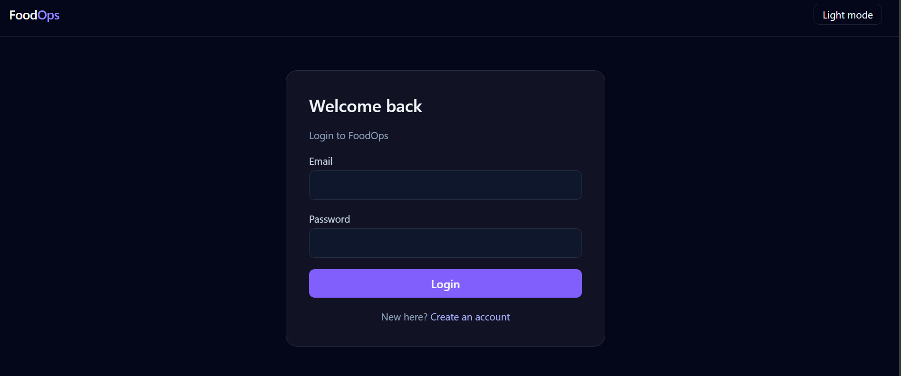
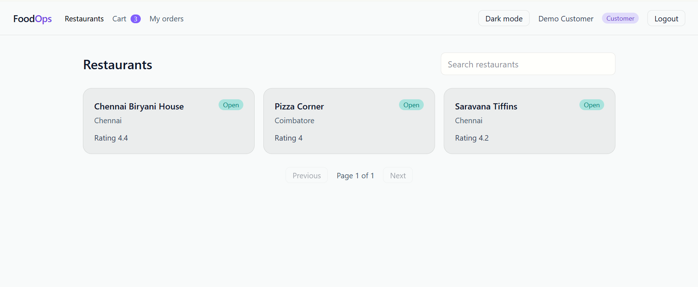
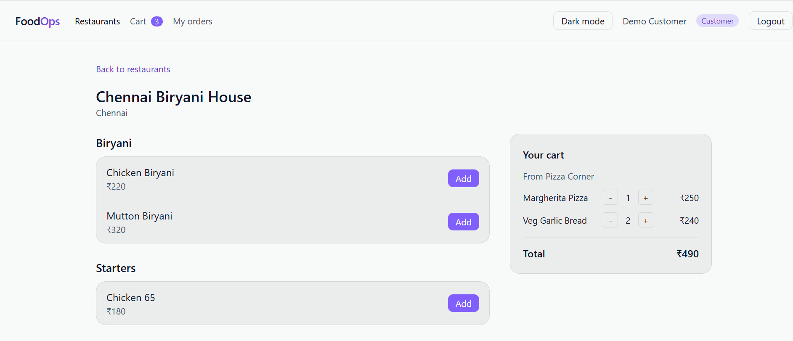
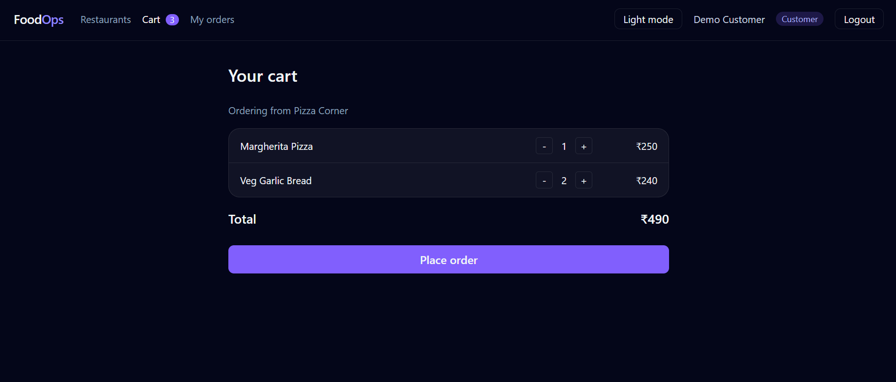
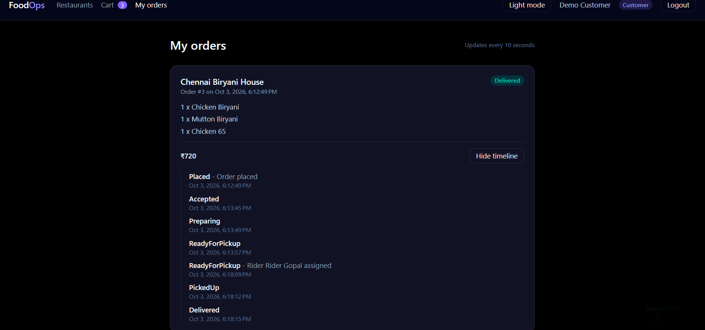
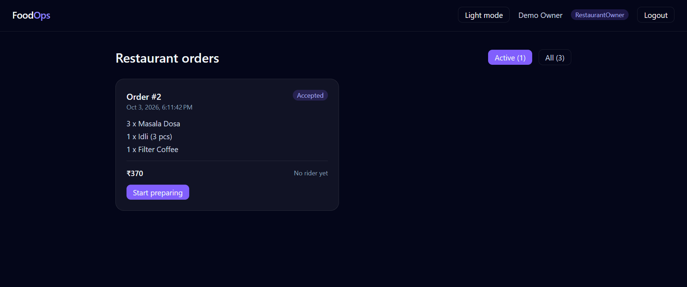
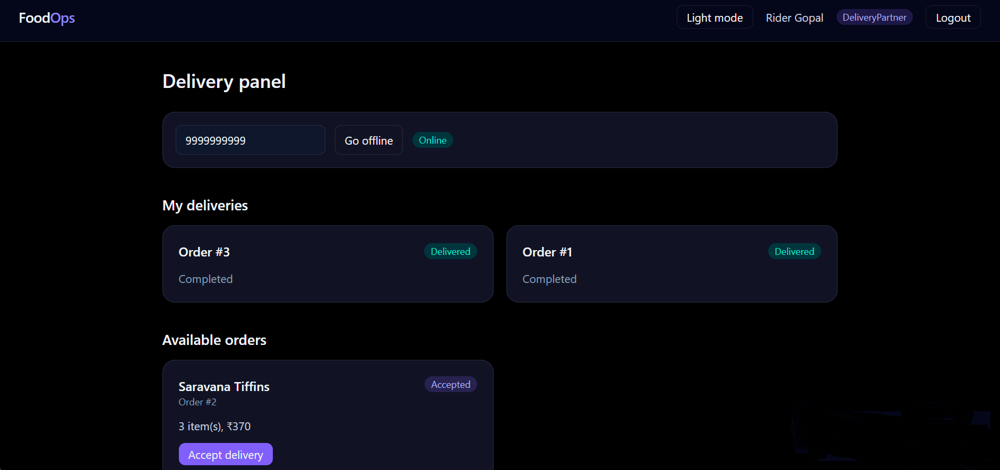
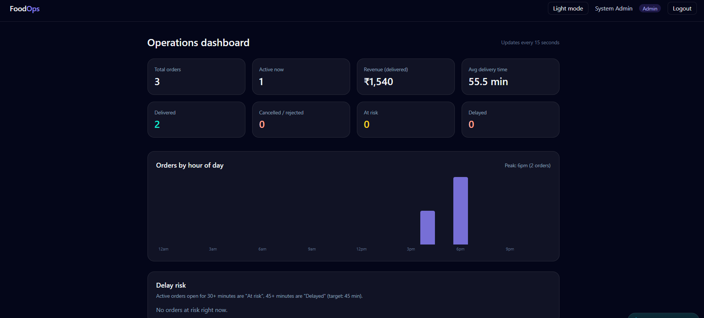
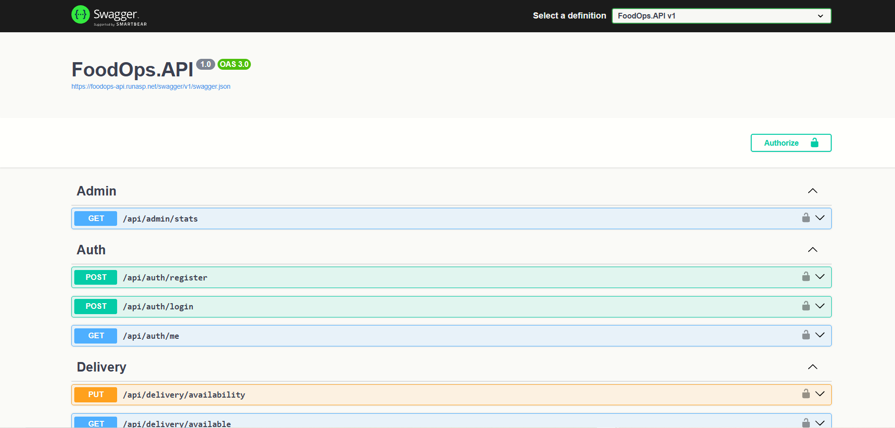

# FoodOps: Food Delivery Operations Platform
[](https://github.com/Gokulram124/FoodOps/actions/workflows/ci.yml)

A full-stack food delivery operations app with four role-based workflows (customer, restaurant owner, delivery rider, admin), built with **ASP.NET Core 8 Web API** (Clean Architecture) and **Angular 22**.

**Live demo:** https://foodops-gokul.netlify.app
**API (Swagger):** https://foodops-api.runasp.net/swagger

> The API runs on a free hosting plan, so the first request after a period of inactivity can take 20 to 30 seconds.

## Demo accounts

| Role | Email | Password |
|---|---|---|
| Admin | admin@foodops.com | Admin@124 |
| Restaurant owner | owner@foodops.com | Owner@123 |
| Customer / Rider | Register a new account from the login page | |

These are demo accounts with sample data only. Please do not enter real personal information.

Try the coupon **WELCOME20** at checkout (20% off, up to ₹100, minimum order ₹200, one use per customer).

## Screenshots

| | |
|---|---|
|  |  |
|  |  |
|  |  |
|  |  |
|  | |

## Features

**Customer**
- Browse restaurants with debounced search and pagination
- Menu with live stock badges ("Only 3 left", "Sold out") that update without a refresh
- Cart and checkout: price and discount are calculated on the server, never trusted from the client
- Coupon codes validated against the server, with the discount shown before placing the order
- My orders with live status updates (SignalR) and a status timeline

**Restaurant owner**
- Sees orders for their own restaurant live and moves them through the allowed statuses
- Manages stock per menu item; stock is restored automatically when an order is cancelled or rejected

**Rider**
- Goes online, claims ready orders and completes deliveries
- Order claiming is atomic (`ExecuteUpdateAsync`), so two riders cannot take the same order

**Admin**
- Dashboard with platform statistics
- Creates restaurant owners and restaurants
- Revenue reports by day, week, month or year, with Excel export
- Creates, lists and disables coupons (percent or flat, minimum order, validity window, usage limit, optionally assigned to one customer)

**Platform**
- JWT authentication with refresh tokens, ASP.NET Core Identity and role-based authorization
- Order status transition rules (strategy pattern) with an audit trail (`OrderStatusLogs`)
- Real-time updates with SignalR (order status and stock changes)
- Global exception-handling middleware and Serilog logging
- EF Core migrations applied and sample data seeded on startup
- Light and dark themes (saved in the browser)

## Tech stack

| Layer | Technology |
|---|---|
| API | ASP.NET Core 8 Web API, C# |
| Architecture | Clean Architecture (API / Application / Domain / Infrastructure), Unit of Work, strategy pattern |
| Data | Entity Framework Core 8, SQL Server |
| Auth | ASP.NET Core Identity, JWT bearer tokens, refresh tokens |
| Real-time | SignalR |
| Reports | ClosedXML (Excel export) |
| Frontend | Angular 22 (standalone components, signals, reactive forms, lazy-loaded routes), RxJS |
| Styling | Bootstrap 5.3 |
| Testing | xUnit, Moq, SQLite in-memory (80 tests) |
| CI | GitHub Actions (build and tests on every push) |
| Hosting | Netlify (frontend), MonsterASP.NET (API and SQL Server) |

## Architecture

```
Angular (Netlify)  --HTTPS/JSON + SignalR-->  ASP.NET Core API (MonsterASP)  -->  SQL Server

FoodOps.API             Controllers, middleware, SignalR hubs, DI, Swagger
FoodOps.Application     DTOs, service interfaces, business rules, discount strategies
FoodOps.Domain          Entities and enums (no dependencies)
FoodOps.Infrastructure  EF Core DbContext, migrations, Identity, service implementations, seeding
FoodOps.Tests           xUnit tests for services and rules
```

Design decisions worth noting:
- DTOs are used for all API input and output, so entities are never exposed.
- `DeleteBehavior.Restrict` on selected relationships avoids SQL Server "multiple cascade paths" errors and protects order history.
- Allowed order status transitions are enforced in the service layer, and every change is logged.
- **Stock and coupons are concurrency-safe.** Stock is reserved with a single atomic statement (`Stock = Stock - qty WHERE Stock >= qty`), so two customers cannot buy the last item. A coupon's usage count is incremented atomically, and a unique index on `(CouponId, UserId)` is the real "one use per customer" guard. Order, stock and coupon changes happen in one transaction and roll back together on any failure.
- Cancelling or rejecting an order releases its stock and coupon use. Releases are idempotent.
- Real-time pushes happen after the transaction commits and are best effort, so a SignalR problem can never fail an order.
- CORS origins and secrets come from configuration; production secrets are not stored in the repository.

## API overview

The API is grouped into Auth, Restaurants, Menu, Orders, Coupons, Delivery and Admin controllers. See the full list with request and response models in Swagger: https://foodops-api.runasp.net/swagger

## Run locally

Prerequisites: .NET 8 SDK, Node.js 22+ or 24, SQL Server (LocalDB or Express).

```bash
git clone https://github.com/Gokulram124/FoodOps.git
cd FoodOps
```

**API**
1. Set `ConnectionStrings:DefaultConnection` and `Jwt:Key` in `FoodOps.API/appsettings.json` (or user secrets).
2. Run the `https` profile (https://localhost:7197). The database is created and seeded automatically on first start.

**Client**
```bash
cd client
npm install
ng serve
```
Open http://localhost:4200.

**Tests**
```bash
dotnet test FoodOps.slnx
```

## Deployment

CI runs the build and tests on every push. Deployment is manual: the API is published with Web Deploy and the Angular build is uploaded to Netlify. Database migrations run automatically when the API starts.

## Known limitations and planned improvements

- SignalR hub groups are joined when a connection starts, so a restaurant created after a user connected gets live updates only after that user reconnects.
- Revenue reports group in memory; for large data this should move to SQL.
- Rider screens still poll instead of using SignalR.
- The rider page does not remember its online status after a page refresh.
- Planned: time-bound offers, customer reviews with owner insights, forgot-password by email, caching, background jobs, Docker, automated deployment.

## Author

**Gokulram P**, .NET developer, Chennai
GitHub: https://github.com/Gokulram124